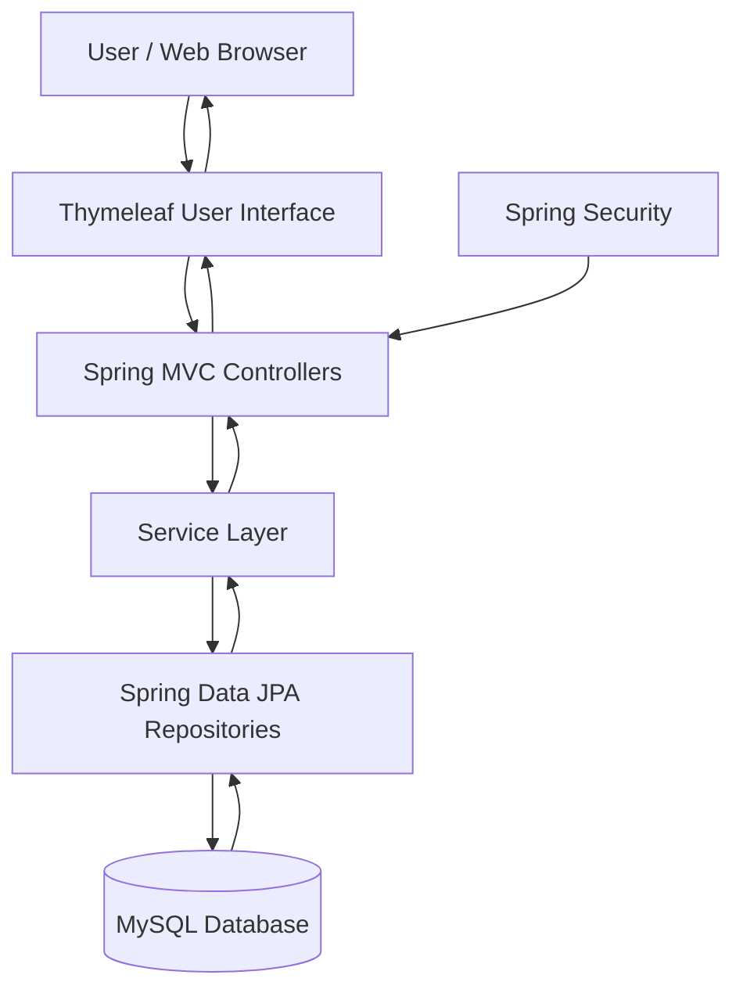
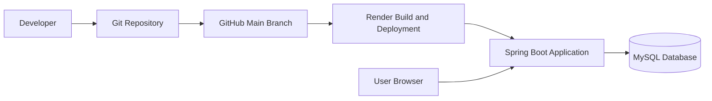

# 🎓 Campus Mate
### Centralized College Information & Student Assistance Platform

<p align="center">
  <b>A centralized digital platform for college information, academic organization, and student assistance.</b>
</p>

<p align="center">
  <a href="https://campus-mate-project.onrender.com">🌐 Live Demo</a> •
  <a href="https://github.com/Afroj881/campus-mate">💻 GitHub Repository</a>
</p>

---

## 📌 Table of Contents

- [Project Overview](#-project-overview)
- [Problem Statement](#-problem-statement)
- [Project Objectives](#-project-objectives)
- [Key Features](#-key-features)
- [User Roles](#-user-roles)
- [Software Requirements Specification](#-software-requirements-specification)
- [Technology Stack](#-technology-stack)
- [System Architecture](#-system-architecture)
- [Project Structure](#-project-structure)
- [Installation and Setup](#-installation-and-setup)
- [Environment Configuration](#-environment-configuration)
- [Database Configuration](#-database-configuration)
- [Application Workflow](#-application-workflow)
- [Testing](#-testing)
- [Deployment](#-deployment)
- [Team Members](#-team-members)
- [Weekly Development and Team Contributions](#-weekly-development-and-team-contributions)
- [Limitations](#-limitations)
- [Future Scope](#-future-scope)
- [Conclusion](#-conclusion)
- [Acknowledgements](#-acknowledgements)

---

## 📖 Project Overview

**Campus Mate** is a Java-based web application designed to provide a centralized platform for college information and student assistance.

Students and faculty often need to access academic information, notices, events, timetables, and learning resources through different channels. Campus Mate aims to simplify this process by organizing supported information and academic tools in one web application.

The platform is designed around three primary user roles:

- Student
- Faculty / Teacher
- Administrator

The application uses Java and Spring Boot for backend development, Thymeleaf for server-side page rendering, and MySQL for database management.

The project focuses on improving accessibility, organizing academic information, and providing role-based access to supported application features.

### Project Information

| Attribute | Details |
|---|---|
| Project Name | Campus Mate |
| Project Category | Web Application |
| Project Domain | College Information and Student Assistance |
| Institution | Arya College of Engineering & IT |
| Department | Artificial Intelligence & Data Science |
| Programming Language | Java |
| Backend Framework | Spring Boot |
| Frontend Technology | Thymeleaf, HTML, CSS, JavaScript |
| Database | MySQL |
| Build Tool | Maven |
| Version Control | Git |
| Source Code Hosting | GitHub |
| Deployment Platform | Render |

---

## ❗ Problem Statement

College students frequently need information about academic schedules, notices, events, and learning resources.

When this information is distributed across multiple platforms, students may find it difficult to locate relevant information and organize their academic activities.

Faculty members and administrators also need organized workflows for managing supported academic and campus information.

Campus Mate aims to address these challenges through a centralized digital platform with role-based access and organized application modules.

### Problems Addressed

- College information may be distributed across different channels.
- Students may have difficulty finding relevant academic information.
- Academic activities and personal tasks can be difficult to organize.
- Different user roles require different access permissions.
- Campus notices and event information need organized management.
- Academic resources benefit from centralized access.

---

## 🎯 Project Objectives

The primary objectives of Campus Mate are:

1. Develop a centralized college information platform.
2. Implement authentication and role-based authorization.
3. Organize college notices and events.
4. Provide access to supported academic information.
5. Support student academic planning.
6. Organize campus clubs and learning resources.
7. Support faculty and administrative workflows.
8. Store application information using a relational database.
9. Develop a user-friendly web interface.
10. Deploy the application online for demonstration and evaluation.
11. Apply software engineering concepts in a practical project.
12. Maintain project documentation and development history.

---

## ✨ Key Features

The following sections describe the intended application areas. The exact functionality of each module should be verified against the current implementation.

### 🔐 1. Authentication and Authorization

The authentication system supports controlled access to the application.

Relevant functionality includes:

- User login.
- Student registration.
- Role-based access control.
- Protected application pages.
- Authentication and authorization checks.
- Password encoding through the configured security system.

Public registration is intended for students. Faculty and administrator accounts follow the application's configured account-provisioning workflow.

### 👨‍🎓 2. Student Portal

The student portal provides access to supported student-facing features.

Potential application areas include:

- Student dashboard.
- College notices.
- College events.
- Timetable information.
- Academic planner.
- Clubs and campus information.
- Learning resources.

### 👨‍🏫 3. Faculty Portal

The faculty portal provides access to supported faculty-related functionality.

Depending on the implementation, this may include:

- Faculty dashboard.
- Academic information.
- Assigned subjects or classes.
- Learning-resource management.
- Faculty-specific application pages.

### 🛡️ 4. Administrator Portal

The administrator portal provides access to supported management features.

Depending on the implemented modules, administrative functionality may include:

- Administrative dashboard.
- Notice management.
- Event management.
- Timetable management.
- Academic calendar management.
- Club and resource management.
- User and role-related administration.

### 📢 5. Notices and Announcements

The notices module is intended to organize important college announcements.

It helps users access relevant information from a centralized location.

### 🎉 6. Events Management

The Events module organizes college event information.

The supported functionality should be verified against the current event controllers, services, repositories, and templates.

### 📅 7. Timetable and Academic Planning

The application is designed to support access to academic schedules and student planning tools.

The exact capabilities should be documented according to the implemented timetable and planner modules.

### 📚 8. Learning Resources

The resources module is intended to organize learning materials and other relevant academic resources.

Any upload, download, or role-specific access functionality should be documented only when confirmed in the source code.

---

## 👥 User Roles

Campus Mate is designed around three primary user roles.

| User Role | Description |
|---|---|
| Student | Accesses supported student-facing features and campus information. |
| Faculty / Teacher | Accesses permitted faculty-related functionality and academic resources. |
| Admin | Manages supported application modules and administrative information. |

### Role-Based Access Control

The application uses authentication and authorization mechanisms to restrict access to protected pages and operations.

The permissions available to each role depend on the application's configured security rules.

---

## 📋 Software Requirements Specification

### Functional Requirements

The application is intended to support the following requirements:

1. Allow users to authenticate.
2. Support student registration.
3. Restrict protected operations according to user roles.
4. Display supported campus information.
5. Organize notices and events.
6. Provide supported academic planning functionality.
7. Organize available learning resources.
8. Support administrative operations for implemented modules.
9. Persist application information in MySQL.
10. Provide a browser-based user interface.

### Non-Functional Requirements

| Requirement | Description |
|---|---|
| Usability | Provide an understandable and navigable interface. |
| Security | Enforce authentication and authorization for protected operations. |
| Maintainability | Organize the application into manageable components. |
| Reliability | Handle expected application errors appropriately. |
| Performance | Keep application and database response times reasonable. |
| Compatibility | Support access through modern web browsers. |
| Data Integrity | Preserve valid application data during database operations. |

These are project requirements and design goals, not independently measured performance or security guarantees.

---

## 🛠️ Technology Stack

| Technology | Purpose |
|---|---|
| Java | Main programming language |
| Spring Boot | Backend application framework |
| Spring MVC | Web request and controller handling |
| Thymeleaf | Server-side HTML rendering |
| HTML5 | Webpage structure |
| CSS3 | Styling and layout |
| JavaScript | Client-side interactions where implemented |
| Spring Data JPA | Database persistence abstraction |
| Hibernate | Object-relational mapping |
| MySQL | Relational database |
| Spring Security | Authentication and authorization |
| Maven | Dependency management and build automation |
| Git | Version control |
| GitHub | Source-code repository |
| Docker | Container-based deployment configuration |
| Render | Application hosting |

Exact dependency versions should be checked in `pom.xml`.

---

## 🏗️ System Architecture

Campus Mate follows a Java web-application architecture using Spring Boot and server-rendered pages.

The following diagram provides a high-level representation of the application.



### Architecture Components

**1. Presentation Layer**

Thymeleaf templates, HTML, CSS, and JavaScript provide the web interface.

**2. Controller Layer**

Spring MVC controllers handle incoming web requests and coordinate application operations.

**3. Service Layer**

Service classes, where present, contain application logic and coordinate data operations.

**4. Repository Layer**

Spring Data JPA repositories provide database persistence operations.

**5. Database Layer**

MySQL stores supported application data.

**6. Security Layer**

Spring Security manages authentication and authorization according to the configured security rules.

---

## 📁 Project Structure

The project uses a Maven-based Spring Boot structure.

The following is a simplified example. The actual repository structure should be treated as authoritative.

```text
campus-mate-project/
│
├── docs/
│
├── src/
│   ├── main/
│   │   ├── java/
│   │   │   └── com/
│   │   │       └── campusmate/
│   │   │           ├── config/
│   │   │           ├── controller/
│   │   │           ├── service/
│   │   │           ├── repository/
│   │   │           ├── model/
│   │   │           └── CampusMateApplication.java
│   │   │
│   │   └── resources/
│   │       ├── templates/
│   │       ├── static/
│   │       └── application.properties
│   │
│   └── test/
│
├── .gitignore
├── Dockerfile
├── pom.xml
└── README.md
```

> **Note:** Confirm the folder names and package structure against the current repository before publishing this section.

---

## 💻 Installation and Setup

Follow these instructions to run the application locally.

### Prerequisites

Install the following tools:

- Java Development Kit compatible with the project.
- Apache Maven or the project's Maven Wrapper.
- Git.
- MySQL Server or an accessible MySQL database.
- A modern web browser.
- An IDE such as IntelliJ IDEA, Eclipse, or Visual Studio Code.

### Step 1: Clone the Repository

```bash
git clone https://github.com/Afroj881/campus-mate-project.git
```

### Step 2: Open the Project Directory

```bash
cd campus-mate-project
```

### Step 3: Configure the Database

Create or select a MySQL database for local development.

Configure the JDBC URL, username, and password using environment variables.

Do not use production database credentials for local development.

### Step 4: Configure Environment Variables

Set the environment variables listed in the next section.

The exact configuration should match the current `application.properties` file.

### Step 5: Build the Application

```bash
mvn clean package
```

### Step 6: Run the Application

```bash
mvn spring-boot:run
```

If the application starts successfully, open the local address configured by the application.

The default Spring Boot port is commonly:

```text
http://localhost:8080
```

Verify the actual port from the application configuration or startup logs.

---

## 🔐 Environment Configuration

The application uses environment variables to configure its database connection and administrator account.

Confirm the exact variable names in the current source code and deployment settings.

| Variable | Purpose |
|---|---|
| `DB_URL` | MySQL JDBC connection URL |
| `DB_USERNAME` | MySQL username |
| `DB_PASSWORD` | MySQL password |
| `CAMPUSMATE_ADMIN_EMAIL` | Administrator email, if account seeding is enabled |
| `CAMPUSMATE_ADMIN_PASSWORD` | Administrator password, if account seeding is enabled |

### Example Configuration

Use placeholders instead of actual credentials.

```text
DB_URL=jdbc:mysql://localhost:3306/campus_mate
DB_USERNAME=your_database_username
DB_PASSWORD=your_database_password

CAMPUSMATE_ADMIN_EMAIL=admin@example.com
CAMPUSMATE_ADMIN_PASSWORD=replace_with_a_strong_unique_password
```

### Security Recommendations

- Never commit real passwords to GitHub.
- Never publish database credentials.
- Store production secrets in the hosting provider's environment settings.
- Use strong, unique passwords.
- Rotate credentials if they are exposed.
- Keep secret-containing local configuration files out of version control.
- Do not place administrator passwords in the README.

---

## 🗄️ Database Configuration

Campus Mate uses MySQL as its relational database.

Spring Data JPA and Hibernate support database persistence and object-relational mapping.

The database configuration includes:

- JDBC connection settings.
- Database authentication.
- JPA and Hibernate configuration.
- Entity persistence.
- Repository-based database operations.

The exact database schema and relationships should be documented using the current entity classes and database configuration.

**Important:** Never delete or reset an existing database simply to configure or deploy the application.

---

## 🔄 Application Workflow

The following workflows describe the intended high-level behavior. Actual navigation depends on the implemented controllers and pages.

### Authentication Workflow

1. A user opens the application.
2. The user selects an available login role.
3. The user enters login credentials.
4. The application validates the credentials.
5. The user receives access according to the assigned role and permissions.
6. The user can log out after completing the session.

### Student Workflow

1. The student opens the application.
2. The student logs in.
3. The student accesses the student dashboard.
4. The student views available campus information.
5. The student uses supported academic tools.
6. The student logs out when finished.

### Faculty Workflow

1. The faculty member opens the application.
2. The faculty member logs in using a provisioned account.
3. The application verifies the assigned role.
4. The faculty member accesses permitted faculty functionality.
5. The faculty member uses supported academic-resource or management features.

### Administrator Workflow

1. The administrator opens the application.
2. The administrator logs in.
3. The application verifies administrative permissions.
4. The administrator accesses available management modules.
5. The administrator performs permitted administrative operations.

---

## 🧪 Testing

Testing is important for verifying application behavior and identifying defects.

### Suggested Testing Areas

| Test Area | Verification |
|---|---|
| Authentication | Valid and invalid login attempts |
| Registration | Input validation and account creation |
| Authorization | Access restrictions for protected pages |
| Role Management | Permissions for supported user roles |
| Database | Supported create, read, update, and delete operations |
| Forms | Required fields and invalid input handling |
| Navigation | Page links and navigation behavior |
| Deployment | Availability of the public application |

### Running Tests

Run the available automated tests using Maven:

```bash
mvn test
```

To perform a full verification build:

```bash
mvn clean verify
```

Only publish actual test counts, pass/fail results, or coverage percentages after verifying them from test output.

---

## ☁️ Deployment

Campus Mate's source code is maintained on GitHub, and the deployed application is hosted on Render.

### Project Links

| Resource | Link |
|---|---|
| Live Application | https://campus-mate-project.onrender.com |
| GitHub Repository | https://github.com/Afroj881/campus-mate |

### Deployment Architecture



### Deployment Process

1. Update the project source code.
2. Verify the application locally where possible.
3. Commit and push the intended changes to GitHub.
4. Allow Render to build and deploy the configured branch.
5. Check the deployment status.
6. Review application logs if deployment fails.
7. Open the live application and verify its behavior.

### Deployment Considerations

- Required environment variables must be configured.
- The database must be accessible from the deployed application.
- The application must bind to the port provided by the hosting environment.
- Secrets must remain private.
- Deployment success must be confirmed through the hosting dashboard and application logs.
- A free hosting instance may take additional time to respond after inactivity.

---

## 👨‍💻 Team Members

Campus Mate is developed by a team of five members.

| No. | Team Member | Roll Number | Assigned Role |
|---:|---|---|---|
| 1 | Afroj Ali | 24EARAD008 | Team Leader & Full-Stack Project Developer |
| 2 | Harshini Choudhary | 24EARAD058 | UI/UX Designer & Frontend Developer |
| 3 | Ayush Saini | 24EARAD027 | Database Design & Backend Support |
| 4 | Divya Joshi | 24EARAD046 | Functional Module Development & Integration Support |
| 5 | Anishka Sharma | 24EARAD012 | Software Testing, Quality Assurance & Documentation |

### Team Responsibilities

#### 1. Afroj Ali
**Role:** Team Leader & Full-Stack Project Developer

Primary responsibilities:

- Project planning and coordination.
- Full-stack development activities.
- Backend and frontend integration.
- Review of application workflows.
- Deployment coordination.
- Overall project progress monitoring.

#### 2. Harshini Choudhary
**Role:** UI/UX Designer & Frontend Developer

Primary responsibilities:

- User-interface planning.
- UI/UX design.
- Frontend page development.
- Interface consistency.
- Usability improvements.
- Frontend verification.

#### 3. Ayush Saini
**Role:** Database Design & Backend Support

Primary responsibilities:

- Database planning.
- Data-model support.
- Database integration.
- Data-persistence verification.
- Backend support.
- Database-related issue investigation.

#### 4. Divya Joshi
**Role:** Functional Module Development & Integration Support

Primary responsibilities:

- Functional module development.
- Module integration.
- Workflow implementation support.
- Functional verification.
- Coordination between application components.

#### 5. Anishka Sharma
**Role:** Software Testing, Quality Assurance & Documentation

Primary responsibilities:

- Test-case preparation.
- Functional testing.
- Regression testing.
- Issue documentation.
- Quality-assurance support.
- Project documentation.

---

# 📅 Weekly Development and Team Contributions

The project follows a planned 12-week academic development timeline, from 6 July 2026 to 27 September 2026.

The sections below provide a structured record of weekly activities. Individual activities must be verified against the team's actual work, progress reports, commits, and other project records before being treated as completed work.

## Week 1: 6 July – 12 July 2026

### Focus
Project planning and requirement analysis.

### Team Contributions

**Afroj Ali — Team Leader & Full-Stack Project Developer**
- Planned the project structure and development approach.
- Analysed initial project requirements.
- Evaluated the proposed technology stack.
- Planned the initial application architecture.

**Harshini Choudhary — UI/UX Designer & Frontend Developer**
- Analysed user-interface requirements.
- Planned the initial dashboard layout.
- Identified important interface components.
- Considered usability and navigation requirements.

**Ayush Saini — Database Design & Backend Support**
- Analysed database requirements.
- Identified the need for structured data storage.
- Planned initial data entities.
- Reviewed database integration requirements.

**Divya Joshi — Functional Module Development & Integration Support**
- Identified the main application modules.
- Analysed functional requirements.
- Reviewed relationships between planned modules.
- Supported initial project planning.

**Anishka Sharma — Software Testing, Quality Assurance & Documentation**
- Prepared initial project documentation.
- Identified areas requiring functional testing.
- Planned initial verification activities.
- Documented project requirements.

### Expected Outcome
A clear understanding of project requirements, technology choices, and planned modules.

---

## Week 2: 13 July – 19 July 2026

### Focus
Application foundation and database planning.

### Team Contributions

**Afroj Ali**
- Worked on the Spring Boot project foundation.
- Reviewed application configuration.
- Planned the backend structure.
- Coordinated initial development tasks.

**Harshini Choudhary**
- Planned the login-page layout.
- Reviewed frontend structure.
- Identified common styling requirements.
- Planned consistent page layouts.

**Ayush Saini**
- Reviewed database configuration requirements.
- Planned the persistence layer.
- Identified database connectivity requirements.
- Supported data-model planning.

**Divya Joshi**
- Reviewed authentication workflows.
- Analysed relationships between functional modules.
- Supported application-structure planning.
- Identified integration requirements.

**Anishka Sharma**
- Prepared preliminary authentication test scenarios.
- Documented expected application behavior.
- Identified validation cases.
- Supported project documentation.

### Expected Outcome
Initial application foundation and a plan for database connectivity and authentication.

---

## Week 3: 20 July – 26 July 2026

### Focus
Authentication and role-based access.

### Team Contributions

**Afroj Ali**
- Worked on authentication-related backend functionality.
- Reviewed login workflows.
- Supported integration between security and application components.
- Coordinated implementation activities.

**Harshini Choudhary**
- Worked on login-interface styling.
- Planned the role-selection interface.
- Reviewed form layout and consistency.
- Supported frontend usability improvements.

**Ayush Saini**
- Supported user-data persistence.
- Reviewed database integration.
- Assisted with data-model requirements.
- Investigated relevant persistence issues.

**Divya Joshi**
- Supported authentication workflow integration.
- Reviewed interactions between login and application modules.
- Helped verify functional requirements.
- Supported integration activities.

**Anishka Sharma**
- Prepared login test scenarios.
- Reviewed input-validation cases.
- Checked expected role-based behavior.
- Documented identified issues.

### Expected Outcome
Progress toward authentication, login workflows, and role-based access.

---

## Week 4: 27 July – 2 August 2026

### Focus
Events module development.

### Team Contributions

**Afroj Ali**
- Coordinated development of the Events module.
- Reviewed the event data structure and backend requirements.
- Supported integration of event-related functionality.
- Reviewed the module's expected workflow.

**Harshini Choudhary**
- Planned event-related interface layouts.
- Reviewed visual consistency.
- Supported event-page presentation.
- Considered usability requirements.

**Ayush Saini**
- Supported event data-structure planning.
- Reviewed persistence requirements.
- Assisted with database integration.
- Supported event-related data operations.

**Divya Joshi**
- Supported functional development of the Events module.
- Reviewed event workflows.
- Assisted with module integration.
- Coordinated functional requirements.

**Anishka Sharma**
- Prepared event-related test scenarios.
- Reviewed expected event workflows.
- Documented possible validation issues.
- Updated project documentation.

### Expected Outcome
Development and integration progress for the Events module.

---

## Week 5: 3 August – 9 August 2026

### Focus
Module integration and interface improvements.

### Team Contributions

**Afroj Ali**
- Reviewed integration between available modules.
- Coordinated application workflow improvements.
- Investigated integration issues.
- Reviewed overall application behavior.

**Harshini Choudhary**
- Improved interface consistency.
- Reviewed existing page layouts.
- Supported frontend refinements.
- Checked visual consistency between modules.

**Ayush Saini**
- Supported database integration.
- Reviewed persistence behavior.
- Assisted with data-related issue investigation.
- Supported backend integration.

**Divya Joshi**
- Supported integration between functional modules.
- Reviewed workflows.
- Assisted with functional improvements.
- Helped coordinate module interactions.

**Anishka Sharma**
- Prepared integrated-feature test scenarios.
- Reviewed application behavior.
- Recorded identified issues.
- Updated testing documentation.

### Expected Outcome
Improved integration between available modules and progress toward consistent application behavior.

---

## Week 6: 10 August – 16 August 2026

### Focus
Testing and bug fixing.

### Team Contributions

**Afroj Ali**
- Reviewed application behavior.
- Coordinated issue investigation.
- Supported backend and integration fixes.
- Reviewed application stability.

**Harshini Choudhary**
- Checked interface behavior.
- Reviewed frontend consistency.
- Identified visible interface issues.
- Supported UI corrections.

**Ayush Saini**
- Reviewed database connectivity and persistence.
- Investigated database-related issues.
- Supported backend data operations.
- Verified relevant database workflows.

**Divya Joshi**
- Reviewed functional workflows.
- Supported integration issue resolution.
- Checked interactions between available modules.
- Assisted with functional verification.

**Anishka Sharma**
- Prepared and executed available test cases.
- Recorded defects.
- Supported regression testing.
- Updated quality-assurance documentation.

### Expected Outcome
Identification and resolution of issues discovered during application verification.

---

## Week 7: 17 August – 23 August 2026

### Focus
Functional improvements and integration.

### Team Contributions

**Afroj Ali**
- Coordinated planned feature improvements.
- Reviewed backend integration.
- Supported application workflow refinement.
- Monitored development progress.

**Harshini Choudhary**
- Reviewed frontend presentation.
- Supported UI refinements.
- Checked navigation consistency.
- Assisted with interface improvements.

**Ayush Saini**
- Supported data-persistence improvements.
- Reviewed database requirements.
- Assisted with relevant backend tasks.
- Checked data consistency.

**Divya Joshi**
- Supported functional module development.
- Reviewed module interactions.
- Assisted with integration.
- Checked supported workflows.

**Anishka Sharma**
- Verified updated functionality.
- Recorded defects and observations.
- Supported regression checks.
- Updated project documentation.

### Expected Outcome
Progress on functional refinements and integration of supported features.

---

## Week 8: 24 August – 30 August 2026

### Focus
Academic planning and timetable workflows.

### Team Contributions

**Afroj Ali**
- Coordinated academic-planning work.
- Reviewed application integration.
- Supported backend workflow implementation.
- Reviewed the overall user flow.

**Harshini Choudhary**
- Reviewed timetable and planning interfaces.
- Supported page-layout improvements.
- Checked visual consistency.
- Helped improve interface usability.

**Ayush Saini**
- Supported persistence for relevant modules.
- Reviewed database requirements.
- Assisted with database integration.
- Checked data-related workflows.

**Divya Joshi**
- Supported functional workflow development.
- Reviewed module integration.
- Assisted with academic-planning functionality.
- Checked interactions between relevant components.

**Anishka Sharma**
- Prepared timetable-related verification scenarios.
- Reviewed planning workflows.
- Recorded issues.
- Updated documentation.

### Expected Outcome
Progress on academic-planning and timetable-related workflows.

---

## Week 9: 31 August – 6 September 2026

### Focus
Learning resources and campus modules.

### Team Contributions

**Afroj Ali**
- Reviewed integration of available campus modules.
- Coordinated application improvements.
- Supported backend integration.
- Reviewed overall module consistency.

**Harshini Choudhary**
- Reviewed resource-related page layouts.
- Supported interface improvements.
- Checked frontend consistency.
- Helped improve navigation.

**Ayush Saini**
- Supported data storage for available modules.
- Reviewed relevant database requirements.
- Assisted with persistence issues.
- Supported backend integration.

**Divya Joshi**
- Supported functional module development.
- Reviewed integration between modules.
- Assisted with workflow verification.
- Coordinated functional requirements.

**Anishka Sharma**
- Prepared test scenarios for available resources.
- Reviewed relevant application workflows.
- Documented identified issues.
- Updated project documentation.

### Expected Outcome
Progress on supported campus and learning-resource modules.

---

## Week 10: 7 September – 13 September 2026

### Focus
Faculty features and application improvements.

### Team Contributions

**Afroj Ali**
- Reviewed role-based application workflows.
- Supported backend integration.
- Coordinated feature improvements.
- Reviewed application behavior.

**Harshini Choudhary**
- Reviewed interface consistency across user roles.
- Supported frontend improvements.
- Checked page layouts.
- Assisted with usability refinements.

**Ayush Saini**
- Supported database integration.
- Reviewed persistence requirements.
- Assisted with data-related issues.
- Checked relevant backend workflows.

**Divya Joshi**
- Supported faculty and academic module integration.
- Reviewed functional requirements.
- Assisted with workflow improvements.
- Helped verify module interactions.

**Anishka Sharma**
- Prepared role-based test scenarios.
- Reviewed access restrictions.
- Recorded testing observations.
- Updated documentation.

### Expected Outcome
Progress on faculty-related functionality and role-based application workflows.

---

## Week 11: 14 September – 20 September 2026

### Focus
Testing, security review, and bug fixing.

### Team Contributions

**Afroj Ali**
- Coordinated application review.
- Supported final integration checks.
- Reviewed identified defects.
- Coordinated required fixes.

**Harshini Choudhary**
- Reviewed frontend behavior.
- Checked interface consistency.
- Supported correction of identified UI issues.
- Reviewed usability.

**Ayush Saini**
- Verified database behavior.
- Reviewed data persistence.
- Investigated database-related defects.
- Supported backend verification.

**Divya Joshi**
- Supported functional testing.
- Reviewed module interactions.
- Assisted with integration issue resolution.
- Verified relevant workflows.

**Anishka Sharma**
- Supported regression testing.
- Recorded and tracked issues.
- Reviewed application behavior.
- Updated quality-assurance documentation.

### Expected Outcome
Improved application verification and resolution of identified issues.

---

## Week 12: 21 September – 27 September 2026

### Focus
Final verification, deployment, and documentation.

### Team Contributions

**Afroj Ali**
- Coordinated final application review.
- Reviewed backend and frontend integration.
- Supported deployment activities.
- Coordinated project completion tasks.

**Harshini Choudhary**
- Reviewed the final user interface.
- Checked frontend consistency.
- Supported final layout refinements.
- Verified the presentation of available pages.

**Ayush Saini**
- Reviewed database configuration.
- Verified relevant persistence workflows.
- Supported database connectivity checks.
- Assisted with final backend verification.

**Divya Joshi**
- Reviewed functional module integration.
- Supported final workflow verification.
- Checked interactions between application components.
- Assisted with final functional review.

**Anishka Sharma**
- Prepared final project documentation.
- Supported testing summaries.
- Reviewed documentation consistency.
- Assisted with quality-assurance records.

### Expected Outcome
Final review of available functionality, deployment readiness, and project documentation.

---

## 📌 Weekly Contribution Verification

The weekly contribution sections provide a documentation structure for recording team activity.

For an accurate project record, each contribution should be verified against one or more of the following:

- College project portal entries.
- GitHub commits and pull requests.
- Team work logs.
- Screenshots of completed features.
- Testing records.
- Project reports and documentation.
- Actual implementation in the source code.

Do not claim that a feature or task was completed unless the available evidence supports that claim.

---

## ⚠️ Limitations

The actual capabilities of Campus Mate depend on the current implementation.

Potential limitations include:

- Some modules may have limited functionality.
- Performance depends on hosting resources and database connectivity.
- A free hosting instance may take additional time to respond after inactivity.
- Some advanced features may require further development.
- Testing coverage and production-readiness require separate verification.

---

## 🔮 Future Scope

Campus Mate can potentially be improved through the following enhancements:

- Advanced academic planning tools.
- Email or in-app notifications.
- Attendance management integration.
- Additional reporting and analytics.
- Improved faculty-student collaboration.
- Better mobile responsiveness.
- Accessibility improvements.
- Expanded automated testing.
- Additional academic-resource management capabilities.
- Enhanced application monitoring.

These are potential improvements and should not be represented as currently implemented features.

---

## 🏁 Conclusion

Campus Mate aims to provide a centralized digital platform for college information and student assistance.

The project brings together supported campus information and academic workflows in a web application designed for students, faculty members, and administrators.

Using Java, Spring Boot, Thymeleaf, MySQL, and related technologies, the project demonstrates the practical application of web development, database management, role-based access, software testing, teamwork, and deployment.

The application and source code can be accessed through the following links.

### 🌐 Live Demo

https://campus-mate-project.onrender.com

### 💻 GitHub Repository

https://github.com/Afroj881/campus-mate

---

## 🙏 Acknowledgements

We would like to thank Arya College of Engineering & IT, our faculty members, and everyone who provided guidance and feedback during the development of Campus Mate.

This project has provided an opportunity to apply software engineering concepts, database management, web application development, testing, documentation, teamwork, and deployment practices in an academic setting.

---

<p align="center">
  <b>Campus Mate — Bringing College Information Together.</b>
</p>
