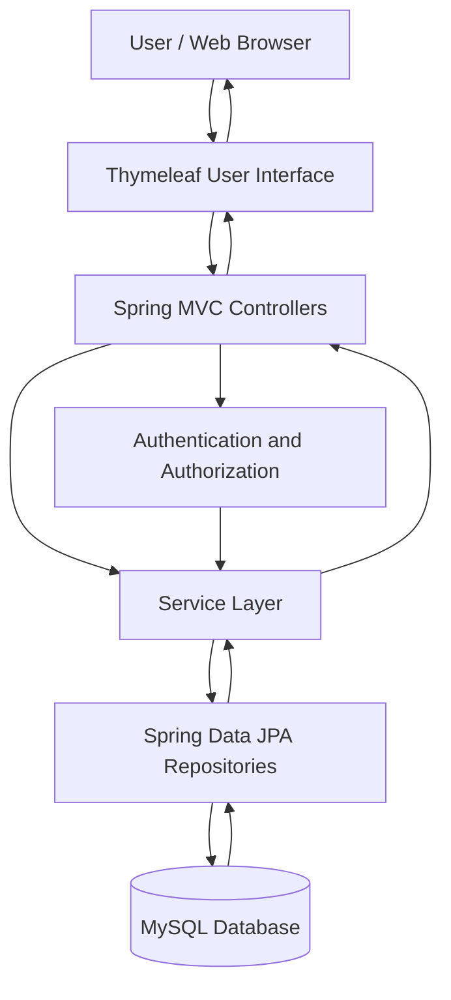
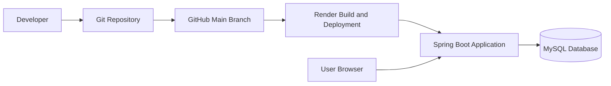

# 🎓 Campus Mate
### Centralized College Information & Student Assistance Platform

Campus Mate is a web-based college management and student assistance platform designed to bring important college information and academic tools into one centralized system.

The project aims to simplify access to college notices, events, timetables, academic resources, and student productivity tools through a role-based web application.

It provides separate access for Students, Faculty/Teachers, and Administrators, helping organize academic information and campus activities in one place.

---

## 🌐 Live Demo

**Live Application:**  
https://campus-mate-project.onrender.com

**GitHub Repository:**  
https://github.com/Afroj881/campus-mate-project

> Note: The application is hosted on Render. On a free hosting instance, the first request after inactivity may take additional time while the service starts.

---

## 📌 Table of Contents

- [Project Overview](#-project-overview)
- [Problem Statement](#-problem-statement)
- [Project Objectives](#-project-objectives)
- [Features](#-features)
- [User Roles](#-user-roles)
- [Software Requirements Specification](#-software-requirements-specification)
- [Technology Stack](#-technology-stack)
- [System Architecture](#-system-architecture)
- [Project Structure](#-project-structure)
- [Getting Started](#-getting-started)
- [Environment Configuration](#-environment-configuration)
- [Database Configuration](#-database-configuration)
- [Application Workflow](#-application-workflow)
- [Testing](#-testing)
- [Deployment](#-deployment)
- [Team Members](#-team-members)
- [Project Development Roadmap](#-project-development-roadmap)
- [Limitations](#-limitations)
- [Future Scope](#-future-scope)
- [Conclusion](#-conclusion)

---

## 📖 Project Overview

Campus Mate is developed to provide a centralized digital platform for college students and faculty.

In many colleges, information such as notices, academic schedules, events, and learning resources may be distributed across different channels. Students may need to visit multiple places to find the information they need.

Campus Mate aims to make this process simpler by organizing relevant academic information and student assistance features within a single web application.

The application uses Java and Spring Boot for backend development, Thymeleaf for server-rendered pages, and MySQL for data persistence.

### Project Information

| Attribute | Details |
|---|---|
| Project Name | Campus Mate |
| Project Type | Web Application |
| Domain | College Information & Student Assistance |
| Institution | Arya College of Engineering & IT |
| Department | Artificial Intelligence & Data Science |
| Backend | Java, Spring Boot |
| Frontend | Thymeleaf, HTML, CSS, JavaScript |
| Database | MySQL |
| Build Tool | Maven |
| Repository | GitHub |
| Hosting | Render |

---

## ❗ Problem Statement

Students and faculty regularly need access to academic schedules, college announcements, events, and learning resources.

When information is scattered across different platforms, users may experience difficulties finding updated information and organizing academic activities.

Campus Mate addresses this problem by providing a centralized web application with role-based access and organized campus information.

### Key Problems

- Difficulty accessing college information from one place.
- Lack of centralized access to notices and event information.
- Difficulty organizing personal academic tasks.
- Need for role-specific access for students, faculty, and administrators.
- Need for a structured platform to organize academic resources.

---

## 🎯 Project Objectives

The main objectives of Campus Mate are:

1. Develop a centralized college information platform.
2. Provide authentication and role-based access.
3. Organize college notices and events.
4. Provide access to timetable and academic information.
5. Support personal academic planning.
6. Organize campus clubs and learning resources.
7. Support faculty and administrator workflows.
8. Maintain application data using a relational database.
9. Provide a user-friendly web interface.
10. Deploy the application online for demonstration and evaluation.

---

## ✨ Features

The following feature descriptions should be checked against the current implementation before being treated as completed functionality.

### 🔐 1. Authentication and Authorization

- User login and logout.
- Student registration.
- Role-based access for supported user types.
- Protected application routes.
- Password encoding and authentication through the configured security system.

### 👨‍🎓 2. Student Portal

The student portal is intended to provide access to relevant academic and campus information.

Potential areas include:

- Student dashboard.
- College notices.
- College events.
- Timetable information.
- Academic planner.
- Clubs and learning resources.
- Student profile management.

### 👨‍🏫 3. Faculty Portal

The faculty portal supports faculty-specific academic workflows where implemented.

These may include:

- Faculty dashboard.
- Subject and class-related information.
- Assigned academic resources.
- Notes or learning-resource management.
- Access to relevant academic calendar information.

### 🛡️ 4. Administration

The administrator area supports management of the application’s available modules.

Depending on the implemented functionality, this may include:

- Administrative dashboard.
- Notice management.
- Event management.
- Timetable management.
- Club and resource management.
- Academic calendar management.
- User and role-related administration.

### 📅 5. Timetable and Academic Planning

The platform is intended to help students access academic schedules and organize personal tasks.

Where implemented, the planner supports task creation, editing, completion, and deletion.

### 📢 6. Notices and Events

The notices and events modules organize important campus information so users can access announcements and event details from the application.

### 📚 7. Learning Resources

The resources module is intended to organize academic learning materials.

Any upload, download, or class-specific access restrictions should be documented according to the actual application code.

---

## 👥 User Roles

Campus Mate is designed around three primary user roles.

| Role | Description |
|---|---|
| Student | Accesses student-facing campus information and supported academic tools. |
| Faculty / Teacher | Accesses faculty-related features and permitted academic resources. |
| Admin | Manages supported application modules and administrative information. |

### Role-Based Access

The application uses authentication and authorization mechanisms to control access to protected pages and operations.

Public registration is intended for students. Faculty and administrator account creation or provisioning depends on the application's configured workflow.

---

## 📋 Software Requirements Specification

### Functional Requirements

The system's functional requirements include the following intended capabilities:

1. Authenticate users.
2. Register student accounts.
3. Restrict access according to user roles.
4. Display relevant campus information.
5. Organize notices and events.
6. Provide supported timetable and academic planning functionality.
7. Organize learning resources.
8. Support administrative management of available modules.
9. Store application data in MySQL.
10. Provide a browser-based interface.

### Non-Functional Requirements

| Requirement | Description |
|---|---|
| Usability | The interface should be understandable and easy to navigate. |
| Security | Protected routes and operations should enforce authorization. |
| Maintainability | The application should use an organized backend structure. |
| Reliability | Application workflows should handle expected errors appropriately. |
| Performance | Pages and database operations should respond within reasonable limits. |
| Compatibility | The web application should be accessible through a modern browser. |
| Data Integrity | Database operations should preserve valid application data. |

These are project requirements and design goals; they are not a claim that every quality attribute has been independently measured.

---

## 🛠️ Technology Stack

| Technology | Purpose |
|---|---|
| Java | Main programming language |
| Spring Boot | Application framework |
| Spring MVC | Web request and controller handling |
| Thymeleaf | Server-side HTML rendering |
| HTML5 | Page structure |
| CSS3 | Styling and layout |
| JavaScript | Client-side interactions where implemented |
| Spring Data JPA | Database persistence abstraction |
| Hibernate | Object-relational mapping |
| MySQL | Relational database |
| Spring Security | Authentication and authorization |
| Maven | Dependency management and build automation |
| Git | Version control |
| GitHub | Source-code repository |
| Docker | Container-based deployment configuration |
| Render | Application hosting |

Exact dependency versions should be verified in `pom.xml` and the deployment configuration.

---

## 🏗️ System Architecture

Campus Mate follows a Java web-application architecture using Spring Boot and server-rendered pages.

The following diagram illustrates the intended request flow. Confirm the exact layers and component names against the current source code.



### Architecture Components

**1. User Interface**

Thymeleaf templates, HTML, CSS, and JavaScript provide the browser-based interface.

**2. Controller Layer**

Spring MVC controllers handle incoming web requests and coordinate application operations.

**3. Service Layer**

Where present, service classes contain application logic and coordinate data operations.

**4. Repository Layer**

Spring Data JPA repositories provide persistence operations for supported entities.

**5. Database Layer**

MySQL stores application data.

**6. Security Layer**

Spring Security manages authentication and access control according to the configured security rules.

---

## 📁 Project Structure

The project is organized as a Maven-based Spring Boot application.

A simplified structure is shown below. Use the actual repository structure as the source of truth.

```text
campus-mate-project/
│
├── docs/
│
├── src/
│   ├── main/
│   │   ├── java/
│   │   │   └── com/
│   │   │       └── campusmate/
│   │   │           ├── config/
│   │   │           ├── controller/
│   │   │           ├── service/
│   │   │           ├── repository/
│   │   │           ├── model/
│   │   │           └── CampusMateApplication.java
│   │   │
│   │   └── resources/
│   │       ├── templates/
│   │       ├── static/
│   │       └── application.properties
│   │
│   └── test/
│
├── .gitignore
├── Dockerfile
├── pom.xml
└── README.md
```

> Important: Folder names and package organization may differ in the actual repository. Keep this section synchronized with the real files.

---

## 🚀 Getting Started

Follow these instructions to run Campus Mate locally.

### Prerequisites

Install the following software:

- A compatible Java Development Kit.
- Apache Maven, or use the project's Maven Wrapper if available.
- Git.
- MySQL Server or another correctly configured MySQL instance.
- A modern web browser.
- An IDE such as IntelliJ IDEA, Eclipse, or Visual Studio Code.

### Step 1: Clone the Repository

```bash
git clone https://github.com/Afroj881/campus-mate-project.git
```

### Step 2: Open the Project

```bash
cd campus-mate-project
```

### Step 3: Configure the Database

Create or select a MySQL database for local development.

Configure the JDBC URL, username, and password through environment variables.

Do not use production database credentials for local development.

### Step 4: Configure Environment Variables

Set the required variables described in the Environment Configuration section.

### Step 5: Build the Project

```bash
mvn clean package
```

### Step 6: Run the Application

```bash
mvn spring-boot:run
```

If the application starts successfully, open the local address and port configured by the application.

For a default Spring Boot configuration, the address is commonly:

```text
http://localhost:8080
```

Confirm the actual port from `application.properties` or the startup logs.

---

## 🔐 Environment Configuration

Database credentials and administrator passwords must be configured securely.

The application configuration has used the following environment-variable names. Confirm them against the latest source code before use.

| Variable | Purpose |
|---|---|
| `DB_URL` | JDBC connection URL for MySQL |
| `DB_USERNAME` | MySQL username |
| `DB_PASSWORD` | MySQL password |
| `CAMPUSMATE_ADMIN_EMAIL` | Administrator account email, if seeding is enabled |
| `CAMPUSMATE_ADMIN_PASSWORD` | Administrator account password, if seeding is enabled |

### Example Configuration

Use placeholders instead of real credentials.

```text
DB_URL=jdbc:mysql://localhost:3306/campus_mate
DB_USERNAME=your_database_username
DB_PASSWORD=your_database_password

CAMPUSMATE_ADMIN_EMAIL=admin@example.com
CAMPUSMATE_ADMIN_PASSWORD=replace_with_a_strong_unique_password
```

### Security Recommendations

- Never commit production passwords to GitHub.
- Do not publish real database connection strings containing credentials.
- Keep private values in environment variables.
- Use a strong, unique administrator password.
- Rotate credentials if they are exposed.
- Keep local configuration files containing secrets out of version control.

---

## 🗄️ Database Configuration

Campus Mate uses MySQL for relational data storage.

Spring Data JPA and Hibernate provide database persistence and object-relational mapping.

The application database configuration includes:

- JDBC connection settings.
- Database authentication.
- JPA and Hibernate configuration.
- Entity persistence.
- Repository-based database operations.

The exact database entities, relationships, and schema should be documented using the current Java entity classes and database configuration.

Do not delete or reset an existing database when configuring the project.

---

## 🔄 Application Workflow

The following is a high-level workflow. The exact steps depend on the implemented routes and pages.

### User Authentication

1. A user opens the application.
2. The user selects the appropriate login role where supported.
3. The user enters their credentials.
4. The application validates the login.
5. The authenticated user is directed to the permitted application area.

### Student Workflow

1. The student logs in.
2. The student opens the dashboard.
3. The student accesses available campus information.
4. The student uses supported academic tools.
5. The student logs out when finished.

### Faculty Workflow

1. The faculty member logs in using a provisioned account.
2. The application checks the user's role and permissions.
3. The faculty member accesses permitted faculty features.
4. The faculty member views or manages supported academic resources.

### Administrator Workflow

1. The administrator logs in.
2. The application verifies administrative permissions.
3. The administrator opens supported management modules.
4. The administrator performs permitted content-management operations.

---

## 🧪 Testing

Testing is necessary to verify that the application behaves as expected.

### Suggested Test Areas

| Test Area | What to Verify |
|---|---|
| Authentication | Valid and invalid login attempts |
| Registration | Required fields and validation |
| Authorization | Protected pages reject unauthorized access |
| Role Management | Each role receives the appropriate permissions |
| Database | Supported create, read, update, and delete operations |
| Forms | Required fields and invalid input handling |
| Navigation | Links and page transitions work correctly |
| Deployment | Public application URL opens successfully |

### Running Automated Tests

Use Maven to run the available test suite:

```bash
mvn test
```

To run the build and tests together:

```bash
mvn clean verify
```

Only report test counts, pass/fail results, and coverage when they have been verified from actual test execution.

---

## ☁️ Deployment

Campus Mate's source code is maintained on GitHub, and the public application is hosted on Render.

### Project Links

| Resource | Link |
|---|---|
| Live Application | https://campus-mate-project.onrender.com |
| GitHub Repository | https://github.com/Afroj881/campus-mate-project |

### Deployment Overview



### Deployment Considerations

- The application must start successfully in the hosting environment.
- Required environment variables must be configured in the hosting dashboard.
- The database must be reachable from the deployed application.
- Database and administrator credentials must remain private.
- The public URL should be checked after each relevant deployment.
- Deployment success should be confirmed from the hosting dashboard and application logs.

---

## 👨‍💻 Team Members

Campus Mate is developed by the following project team.

| No. | Team Member | Roll Number | Role |
|---:|---|---|---|
| 1 | Afroj Ali | 24EARAD008 | Team Leader & Full-Stack Project Developer |
| 2 | Harshini Choudhary | 24EARAD058 | UI/UX Designer & Frontend Developer |
| 3 | Ayush Saini | 24EARAD027 | Database Design & Backend Support |
| 4 | Divya Joshi | 24EARAD046 | Functional Module Development & Integration Support |
| 5 | Anishka Sharma | 24EARAD012 | Software Testing, Quality Assurance & Documentation |

### Team Responsibilities

**Afroj Ali — Team Leader & Full-Stack Project Developer**

Responsible for overall project coordination, full-stack development activities, integration, and deployment coordination.

**Harshini Choudhary — UI/UX Designer & Frontend Developer**

Responsible for interface design, visual consistency, usability, and frontend development activities.

**Ayush Saini — Database Design & Backend Support**

Responsible for database planning, data-model support, and backend integration activities.

**Divya Joshi — Functional Module Development & Integration Support**

Responsible for functional module development and supporting integration between application components.

**Anishka Sharma — Software Testing, Quality Assurance & Documentation**

Responsible for testing coordination, quality checks, documentation, and recording issues found during verification.

---

## 📅 Project Development Roadmap

The project was planned as a 12-week academic development effort.

The following table provides a high-level roadmap. Exact completion dates and weekly status should be confirmed against the team's work logs and repository history.

| Week | Planned Focus |
|---|---|
| Week 1 | Project research and requirement analysis |
| Week 2 | Spring Boot foundation and database planning |
| Week 3 | Student registration and login |
| Week 4 | Authentication and role-based access |
| Week 5 | Student and administrator dashboards |
| Week 6 | Notice management |
| Week 7 | Events management |
| Week 8 | Timetable and academic planner |
| Week 9 | Clubs, learning resources, and search |
| Week 10 | Faculty features and academic calendar |
| Week 11 | Testing, security checks, and bug fixing |
| Week 12 | Final verification, deployment, and documentation |

This roadmap represents the intended development sequence. It should not be treated as proof that every module was completed during its assigned week.

---

## ⚠️ Limitations

The application's actual capabilities depend on the current implementation and deployment configuration.

Potential limitations to verify include:

- Some modules may have limited functionality.
- Application performance depends on hosting resources and database connectivity.
- A free hosting instance may take additional time to respond after inactivity.
- Some advanced features may require future development.
- Test coverage and production-readiness have not been established by this README alone.

---

## 🔮 Future Scope

Possible future improvements include:

- More advanced academic planning tools.
- Email or in-app notifications.
- Attendance integration.
- Enhanced analytics and reporting.
- Additional faculty-student collaboration features.
- Improved mobile responsiveness.
- Accessibility improvements.
- More comprehensive automated testing.
- Expanded academic resource management.

These are possible future enhancements, not claims that the features already exist.

---

## 🏁 Conclusion

Campus Mate aims to provide a centralized digital platform for college information and student assistance.

By bringing supported campus information and academic tools into one web application, the project seeks to improve accessibility, organization, and usability for students, faculty, and administrators.

The project demonstrates the use of Java, Spring Boot, Thymeleaf, MySQL, and related web technologies to build a role-based academic application.

The repository and live demonstration are available below.

**Live Demo:**  
https://campus-mate-project.onrender.com

**GitHub Repository:**  
https://github.com/Afroj881/campus-mate-project

---

## 🙏 Acknowledgements

We would like to thank Arya College of Engineering & IT, our faculty members, and everyone who provided guidance and feedback during the development of Campus Mate.

This project has provided an opportunity to apply software development concepts, database management, web application architecture, teamwork, testing, and deployment practices in an academic setting.
